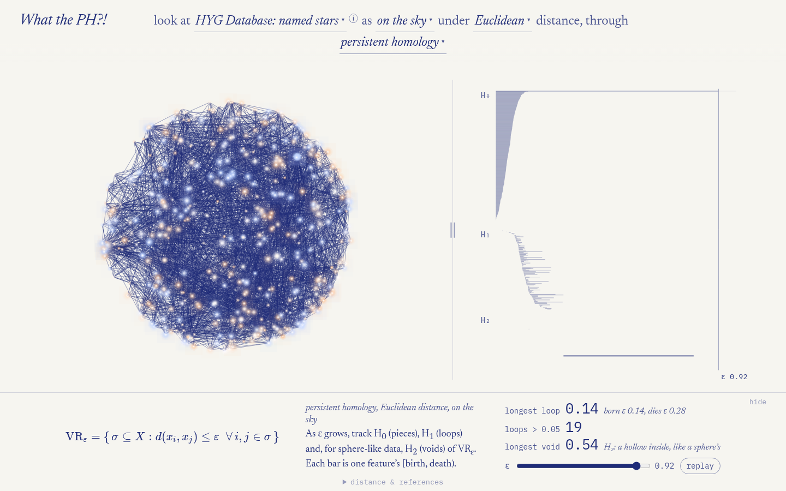
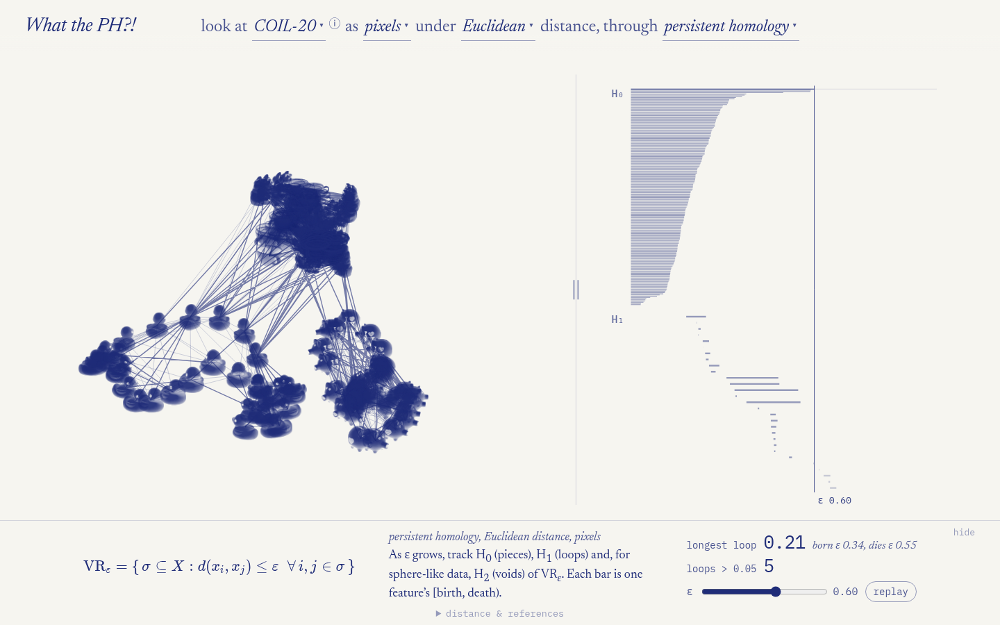
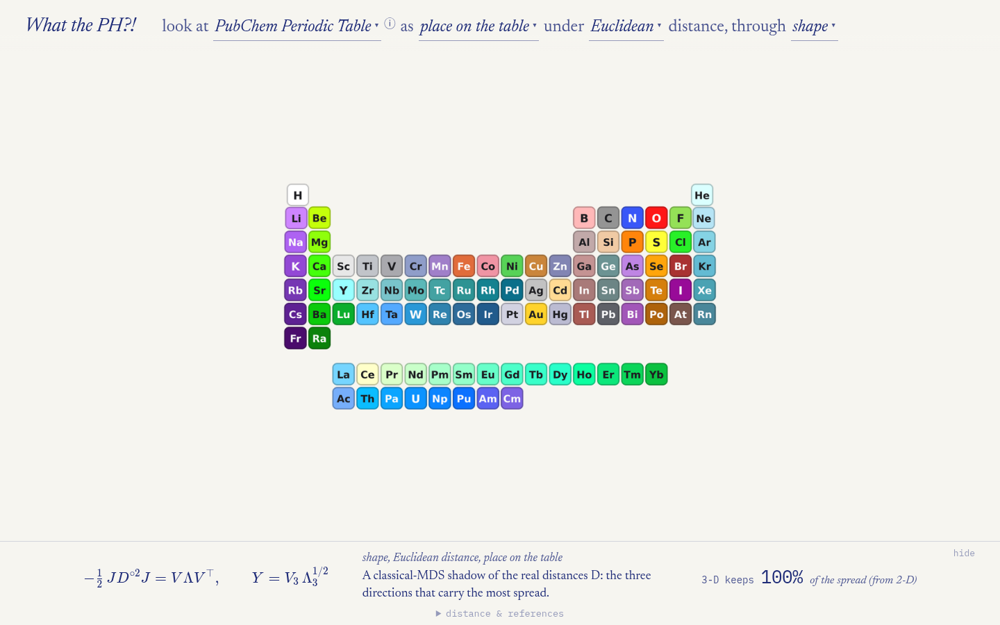
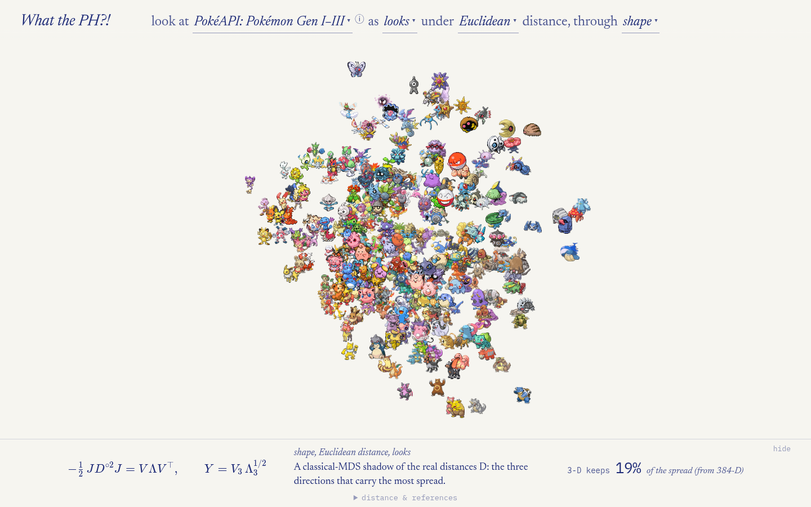
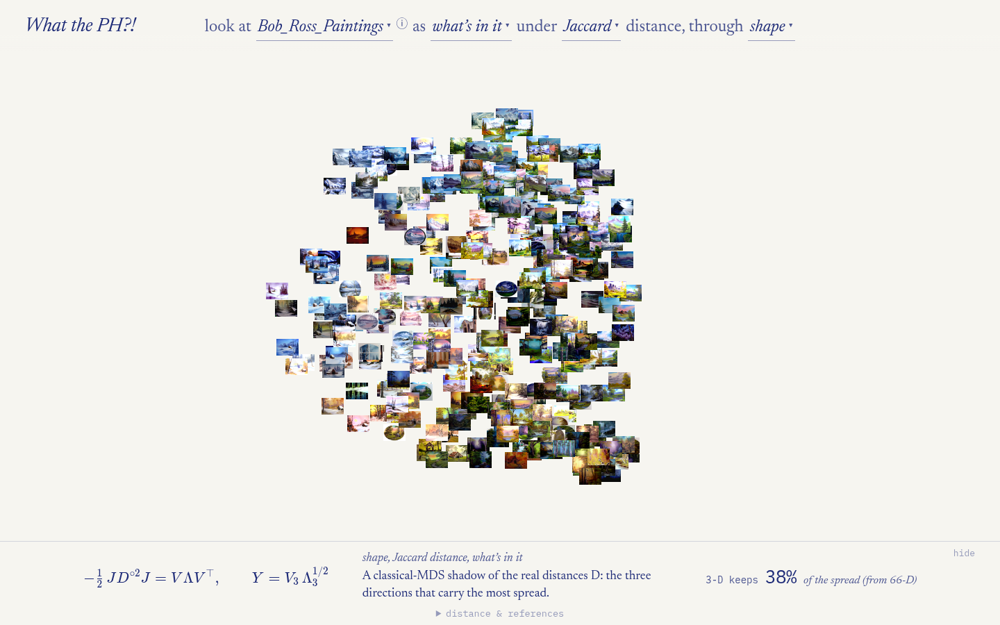
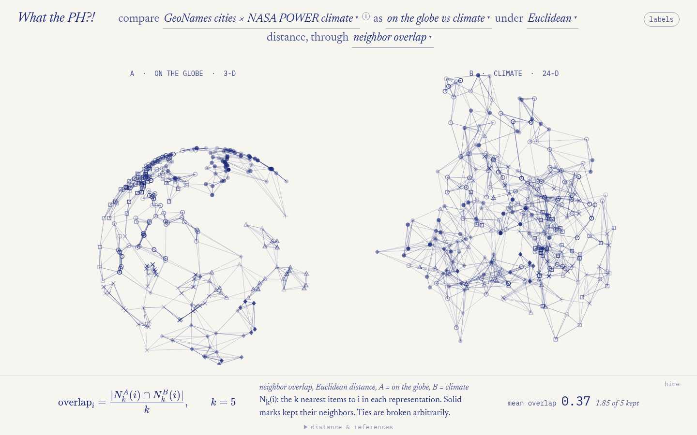
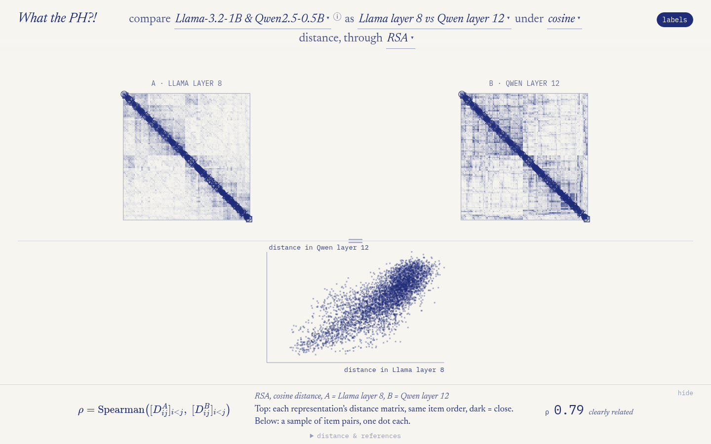
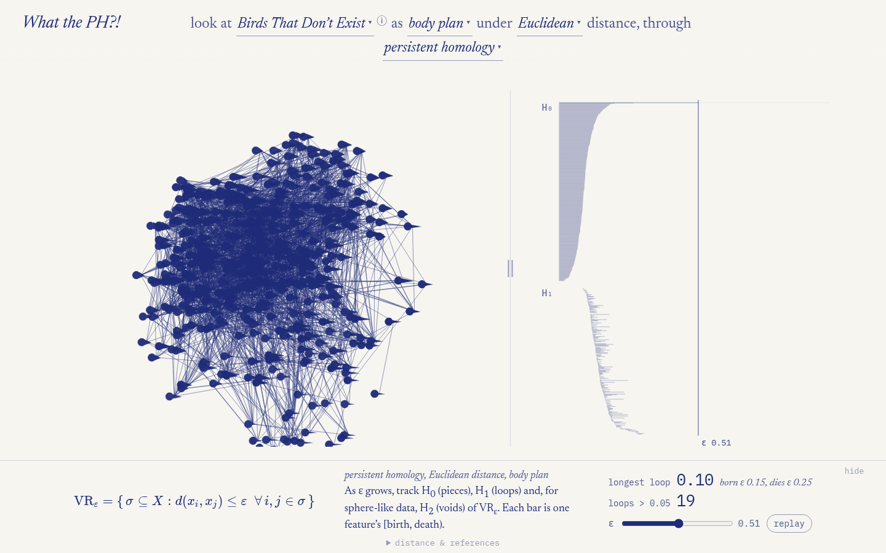
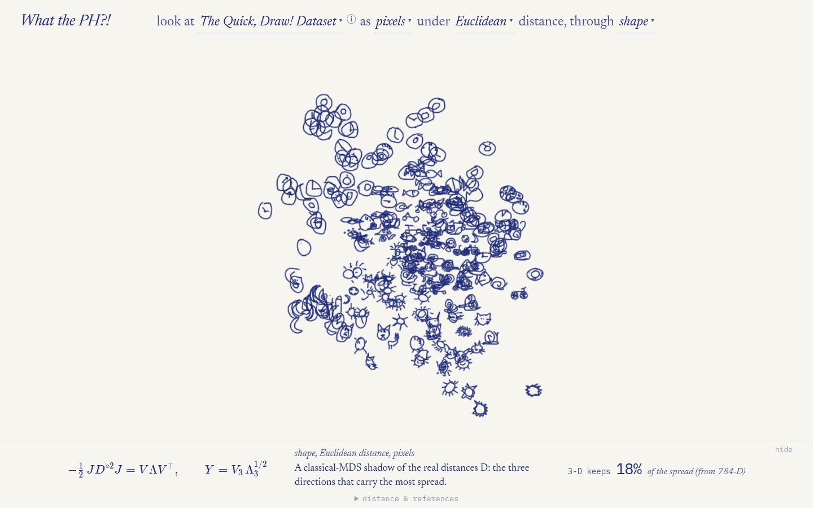

# What the PH?!

A small, nerdy browser toy: real point clouds — star positions, songbird bodies,
Pokémon, fungal DNA, the numbers 0–99 inside a language model — looked at through
the lenses people use to compare representations: **persistent homology**, RSA,
CKA, Procrustes, nearest-neighbour overlap and intrinsic dimension. Pick a dataset,
one cloud or two, a distance and an analysis; the sentence at the top reads like
the question you're asking.

Not rigorous. All real data.



| | |
|---|---|
|  |  |
|  |  |
|  |  |
|  |  |

## Run it

No build step — it's a static page.

```sh
python3 serve.py          # http://127.0.0.1:8562 (+ your tailnet address, if any)
# or any static server:  python3 -m http.server
```

Links are shareable: `#turntable/euclidean/ph/a` is COIL-20, pixels, Euclidean
distance, persistent homology. Scroll to zoom the cloud, drag to turn it,
shift-drag to pan, double-click to reset, ← → to step through analyses,
`h` to hide the caption.

## What's in it

| dataset | items | two views |
|---|---:|---|
| Calendar words | 12 months | fastText · Qwen2.5-0.5B layer 10 |
| Aligned word vectors | 46 cyclic words | English · Russian fastText |
| Numbers 0–99 | 100 | Llama-3.2-1B · Qwen2.5-0.5B |
| Clock faces | 144 times | rendered clock pixels · Llama-3.2-1B reading "3:15" |
| Grambank | 300 languages | where it's spoken (a sphere) · grammar |
| COIL-20 | 5 objects × 36 angles | pixels · DINOv2 |
| The Quick, Draw! Dataset | 240 doodles | pixels · DINOv2 |
| MNIST | 300 digits | pixels · DINOv2 |
| emoji2vec | 209 emoji | emoji2vec · Qwen reading the Unicode name |
| Pokémon Gen I–III | 386 | battle stats · how the sprite looks (DINOv2) |
| HYG named stars | 450 | 3-D position · position on the sky (a sphere) |
| Cities × climate | 300 | the globe (a sphere) · 12 months of temperature and rain |
| PubChem periodic table | 96 elements | properties · place on the table |
| Birds That Don't Exist | 420 songbirds | body plan (the published morphospace gap) · ecology |
| Egg shapes | 420 bird species | egg shape · wings and lifestyle |
| UNITE fungi | 247 species | DNA 4-mers · a DNA language model |
| Cell cycle (FUCCI) | 400 cells | two-colour reporter · gene expression |
| Halloween candy | 85 | ingredients · sugar, price, popularity |
| Bob Ross | 400 episodes | what's in the painting · paints used |

Each dataset's ⓘ shows the creators' own description and citations; each analysis
lists the papers behind it under "distance & references".

## How it works

- `prep/build.py` computes **everything** the page shows and writes
  `data/<id>.json` (labels, thumbnails, CKA and its chance level, citations) plus
  `data/<id>/<distance>.json` for every distance that makes sense for that
  dataset: a classical-MDS shadow, the condensed distance matrix, ripser barcodes
  (H₂ too, for the spheres), k-NN lists, TwoNN, Procrustes with a shuffled-chance
  baseline, RSA. The browser never computes geometry; it only animates.
- `prep/datasets/<id>.py` — one module per dataset (`load()` returns two views of
  the same items), with `<id>.meta.json` holding official names and quotes.
- `js/scene.js` — the single canvas renderer; `js/main.js` — the sentence pickers,
  caption and routing; `js/lenses.js` — each analysis as an equation, a legend
  and a readout; `js/refs.js` — the citations.

Rebuilding the data needs the raw downloads (not in this repo; each dataset
module says where they come from) and a Python env:

```sh
cd prep && uv sync && uv run python build.py            # everything
uv run python build.py stars                             # one dataset
```

## Credits and licences

The **code** is MIT-licensed (see `LICENSE`). The **data** belongs to its
creators and keeps its own terms; this is a free, non-commercial, educational toy.

- **HYG star database** — CC BY-SA 4.0 (so `data/stars*` is CC BY-SA 4.0 too).
- **GeoNames** — CC BY 4.0. **NASA POWER** climatology (MERRA-2), courtesy of the
  NASA POWER project.
- **Grambank** (Skirgård et al. 2023) and **Glottolog** — CC BY 4.0.
- **AVONET** and **Chia et al. 2026** ("Birds That Don't Exist") — CC BY 4.0.
  Egg-shape data (Montgomerie et al. 2021) — CC0.
- **UNITE** fungal ITS release — CC BY 4.0. The fungal *embeddings* come from
  InstaDeep's Nucleotide Transformer (CC BY-NC-SA 4.0), so `data/fungi*` is
  non-commercial, share-alike.
- **Single-cell cell-cycle data** — GEO GSE146773 (Mahdessian et al. 2021).
- **PubChem** periodic table — public domain.
- **PokéAPI** data (BSD-3) and sprites. Pokémon and their sprites are © Nintendo,
  Creatures Inc. and GAME FREAK inc. / The Pokémon Company, used here
  non-commercially.
- **Bob Ross**: FiveThirtyEight's episode data (CC BY 4.0) and Jared Wilber's
  Bob_Ross_Paintings data; painting thumbnails © Bob Ross Inc., used here
  non-commercially.
- **FiveThirtyEight** candy data — CC BY 4.0. **emoji2vec** — MIT.
  **The Quick, Draw! Dataset** — CC BY 4.0. **COIL-20** (Columbia CAVE) and
  **MNIST** — see their pages.
- **fastText** word vectors — CC BY-SA 3.0. **Qwen2.5** and **DINOv2** — Apache 2.0.
- **Built with Llama** — the clock and number datasets use Llama-3.2-1B under the
  Llama 3.2 Community License.

If you own something here and would rather it weren't, open an issue and it'll
come out.
